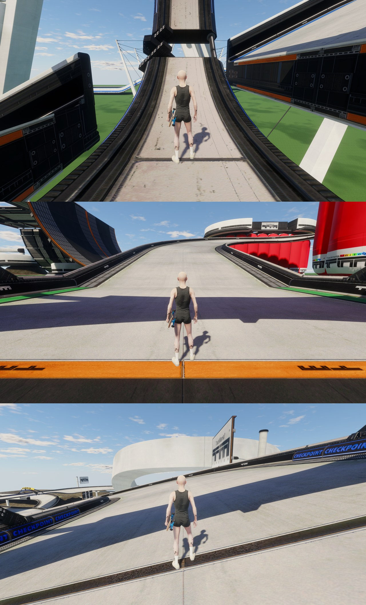

# TrackMania for skate.

TrackMania Nations Forever maps as skateable maps for skate., through ReSkate, rebuilt block by block from the game's
own models, materials and collision with [primase](https://github.com/kalmarv/primase). An unofficial fan port:
TrackMania Nations Forever is by Nadeo and Ubisoft; each map is its author's.



Three maps, each its own package (`TrackMania_<Title>`):

| Map | Author | From |
| --- | --- | --- |
| A01-Race | Nadeo | the Nations campaign that ships with the game |
| Turbulence | matto | [TrackMania Exchange 1354053](https://tmnf.exchange/trackshow/1354053) |
| Iron Maiden | torress | [TrackMania Exchange 136547](https://tmnf.exchange/trackshow/136547) |

## How it's made

`program/src/recipe.rs` is the whole conversion of a map: primase reads the map and every block it places from the
game's packs (`primase-trackmania`, on [gbx-formats](https://github.com/kalmarv/gbx-formats)), lowers it to plain
geometry, materials and collision, prepares it for skate. and writes a ReSkate map, which ReSkate Studio compiles into
a mod. What the port chooses (lights, cutoffs, texture sizes, markers) is in `program/src/choices.rs`; the maps it
builds are in `program/src/maps.rs`.

```
cargo run --release -p trackmania-export -- --out build --studio <ReSkate Studio reskate_cli.exe> [a01 turbulence iron-maiden]
cargo run --release -p trackmania-tools -- package --out build --dest releases --version <version> [--icons <folder>]
kit/run game --job -- env BUILD=<build> "$BASH" tools/ingame_levels.sh <tag>     # every map in one skate. launch
```

It needs your own copy of TrackMania Nations Forever (free on Steam; `--install` if it is not in Steam's default
folder) and of skate. The exchange maps are read from `maps/<id>.Gbx` (`--exchange` for another folder): download
each from `https://tmnf.exchange/trackgbx/<id>`. Nothing from the game or the exchange is in this repository.

- `program/`: the conversion. `tools/trackmania-tools/`: packaging and the in-game check's commands.
- `tools/ingame_levels.sh`: loads every built map in skate. and shoots its spawn and three travel points.
- `tools/ingame_drop.sh`: drops the skater onto each map's travel points (the collision under skate.'s physics).
- `media/`: the pictures the packages' pages show (shots in skate., and each map's pause map picture).

## In the maps

- Every block with the game's own collision; the start is the spawn, every checkpoint and the finish a fast-travel
  point (snapped to the ground below it), named Start, Checkpoint 1, 2, ... and Finish.
- Lit by skate.'s sun and sky (noon). Grass blade fins, additive glows and the fake shadows under objects have no
  material skate. draws and are left out; water is a still, solid surface; screens draw lit.
